<p align="center">
  <a href="https://abubakr-alsheikh.netlify.app">
    
  </a>
</p>

<p align="center">
  
</p>

<p align="center">
  <a href="https://abubakr-alsheikh.netlify.app"></a>
  <a href="https://linkedin.com/in/abubakr-alsheikh"></a>
  <a href="mailto:AbubakrAlsheikh@outlook.com"></a>
  <a href="https://t.me/AbubakrAlsheikh"></a>
  <a href="https://x.com/AbubakrAlshei77"></a>
</p>

<p align="center">
  
</p>

<p align="center"></p>

### `▸ 01 // OPERATOR`

I'm a full-stack software engineer. I design APIs, data models and the interfaces on top of them, build them end to end, and keep them running in production.

I'm not tied to one stack. Most days it's **Python and Django** or **Node.js** on the server, **React and Next.js with TypeScript** on the client, and **PostgreSQL** underneath, shipped with **Docker and CI**. When a project already runs on something else, I work in that.

<p align="center">
  
</p>

<p align="center"></p>

### `▸ 02 // FLIGHT LOG`

| `MOD` | Project | What it does | Links |
|:--:|:--|:--|:--|
| `01` | **Mizan** | Household budget app. Log spending from Telegram by text, voice note or receipt photo, and get one number back: what you can safely spend today. | [Live](https://mizans.netlify.app) · [Case study](https://abubakr-alsheikh.netlify.app/projects/mizan) |
| `02` | **Max CLI** | Open-source terminal assistant on PyPI: 73 commands for video, audio, PDF, image and file tasks, an AI agent and a dashboard. | [Repo](https://github.com/Abubakr-Alsheikh/max-cli) · [Docs](https://abubakr-alsheikh.github.io/max-cli/) |
| `03` | **NanoManga Studio** | Turns a one-line idea into finished manga pages with Gemini, keeping characters consistent from page to page. | [Repo](https://github.com/Abubakr-Alsheikh/nanomanga-studio) · [Live](https://nanomanga-studio.vercel.app) |
| `04` | **NexusDesk AI** | Support-ticket service that triages tickets with an LLM on a background queue, with validated output and retries. | [Repo](https://github.com/Abubakr-Alsheikh/nexusdesk-ai) |
| `05` | **Smart Markdown Pro** | Local-first markdown editor with AI formatting and server-side PDF export. | [Repo](https://github.com/Abubakr-Alsheikh/smart-markdown-pro) |

<sub>More projects, with diagrams and case studies, on the <a href="https://abubakr-alsheikh.netlify.app/#projects">portfolio</a>.</sub>

<p align="center"></p>

### `▸ 03 // ENGINE`

<table>
  <tr>
    <td><code>LANGUAGES</code></td>
    <td></td>
  </tr>
  <tr>
    <td><code>BACKEND</code></td>
    <td> </td>
  </tr>
  <tr>
    <td><code>FRONTEND</code></td>
    <td> </td>
  </tr>
  <tr>
    <td><code>DATA</code></td>
    <td> </td>
  </tr>
  <tr>
    <td><code>OPS</code></td>
    <td></td>
  </tr>
  <tr>
    <td><code>TESTING</code></td>
    <td></td>
  </tr>
  <tr>
    <td><code>MOBILE · DESIGN</code></td>
    <td></td>
  </tr>
</table>

<p align="center"></p>

### `▸ 04 // CURRENT TRAJECTORY`

```diff
+ [STUDYING]   AWS Certified Solutions Architect - Associate
+ [STUDYING]   B.Sc. IT Engineering · Aleppo University & Syrian Virtual University
+ [CERTIFIED]  Meta Generalist Software Engineer
!              Front-End · Back-End · Database Engineer · Android
+ [SHIPPING]   Mizan, Max CLI, and client web apps
```

<p align="center"></p>

### `▸ 05 // TELEMETRY`

<p align="center">
  
  
</p>

<p align="center">
  
</p>

<p align="center"></p>

### `▸ 06 // ORBITAL SCAN`

<p align="center">
  
</p>

<p align="center"></p>

### `▸ 07 // OFF-DUTY`

<p align="center">
  
</p>

<p align="center">
  
</p>

<p align="center">
  
</p>
